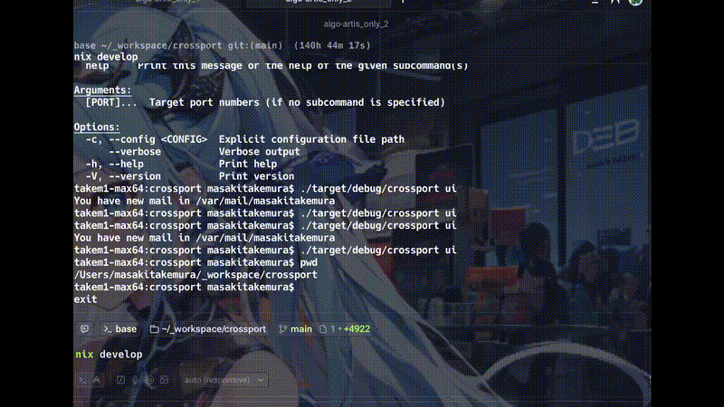

# Crossport

**「8080番、誰が使ってる？」をもう推測しない。** 取得できるGit/Docker/K8s情報とともに、ローカルのTCP待受ポートを表示・管理するツール。

[🇺🇸 English](./README.md)

[](https://github.com/mt4110/crossport/actions)
[](./LICENSE)

<p align="center">
  
</p>

## なぜ Crossport?

単なるプロセス終了ツールではなく、`crossport` は開発者のために作られました：

- **プロジェクト認識** – `node` や `python` だけでなく、どの**プロジェクト**がポートを使っているかを表示
- **Docker / K8s 統合** – コンテナ名やKubernetesサービスのターゲットを自動解決して表示
- **インタラクティブ TUI** – キーボードで操作できるリアルタイムプロセスマネージャー (`crossport ui`)
- **優しい終了戦略** – `SIGINT` → `SIGTERM` → `SIGKILL` の順に試行（Unix）
- **スマートポート検索** – 空きポートを探して `.env` ファイルを自動更新
- **Unixパイプライン** – スクリプト用にJSON出力が可能 (`crossport scan --json | jq ...`)

## インストール

### GitHub Releases (推奨)

[Releases](https://github.com/mt4110/crossport/releases) ページからお使いのOS用のバイナリをダウンロードしてください。

### ソースからビルド

```bash
git clone https://github.com/mt4110/crossport.git
cd crossport
cargo install --path .
```

### Nix を使用する場合

```bash
nix develop
cargo run -- ui
# Build without entering the shell:
nix build
./result/bin/crossport ui
# Or run directly:
nix run . -- ui
```

Rust 1.98.1と依存元を`flake.lock`で固定しています。macOS/Linux向けです。
初回はツールチェーンと依存のダウンロードが必要です。Docker/Kubernetesの識別には、
ホスト側のDocker/kubectlとアクセス権が別途必要です。

## クイックスタート

### インタラクティブモード (TUI)

推奨される使用方法です：

```bash
crossport ui
```

**操作:**

- `j` / `k` または ↑/↓ – 移動
- `Enter` – 詳細を表示
- `/` – フィルター、`s` / `S` – ソート項目・方向を変更
- `h` – セッション・保存済み履歴、`r` – コンテナ再起動の確認
- `x` – プロセス全体の終了確認を表示
- 詳細・終了確認では `j` / `k`・矢印・PageUp/PageDownでスクロール
- `Esc` – 詳細を閉じる。終了確認では `y` で実行、`n` / `Esc` で取り消し
- `q` – 終了

詳細には実行ファイル、macOSのアプリバンドル、親プロセス、選択時点の起動経過時間、
作業ディレクトリ、引数、同じPIDの全TCP待受ポートを表示します。長い情報は折り返します。
終了確認はフィルターで隠れたポートも含み、プロセス全体への影響を示します。
終了直前にPID・起動時刻・実行ファイルを再確認し、不一致や起動時刻の取得不足では中止します。
ただし、この確認は終了処理全体でのPID再利用を完全に防ぐものではありません。

待受中は利用中を意味しません。最終利用日時・自動再起動の有無は監視していないため不明です。
終了操作は未保存の作業に影響し、強制終了へ進む場合があります。

### コマンドライン

#### ポートスキャン

```bash
# デフォルト範囲をスキャン (3000-9999)
crossport scan

# 特定の範囲をスキャン
crossport scan --from 8000 --to 9000

# JSON出力（スクリプト用）
crossport scan --json | jq '.[] | select(.kind == "docker")'
```

**出力例:**
```
PORT   PID      USER     CMD      KIND     PROJ
3000   39338    user     node     dev      my-frontend
5432   12456    user     postgres docker   my-db-container
8080   67890    user     kubectl  k8s      svc/backend-api
```

#### プロセス終了

```bash
# 対話的な確認付きで終了（デフォルト）
crossport kill 3000

# 確認付きで強制終了（確認設定が有効な場合）
crossport kill 3000 --force

# 何が終了されるかを確認（ドライラン）
crossport kill 3000 --dry-run
```

#### 空きポート提案

```bash
# 3000番から順に空きポートを探す
crossport suggest

# .env ファイルを自動更新
crossport suggest --env .env.local --key PORT
```


### 現行リリース

`v0.5.0` が正式リリースです。
GitHub Releaseからバイナリと `SHA256SUMS` を取得するか、Nixで実行できます。

```bash
nix run github:mt4110/crossport/v0.5.0 -- --version
nix run github:mt4110/crossport/v0.5.0 -- ui
```

Gitタグに署名します。配布バイナリのコード署名・公証は行っていません。

## 設定

設定ファイルを次の優先順で1つ選択します（ファイル間のマージはしません）。
明示したファイルが存在しない場合、未知のキー・不正な値はエラーになります。

1. `--config PATH` で指定したファイル
2. `./crossport.toml`
3. `~/.config/crossport/config.toml`

対応するCLIオプションは設定値より優先されます。`kill` の設定はCLIの終了操作用です。
TUIの終了操作は確認付きの段階的終了を使います。設定一覧は
[設定例](config/crossport.example.toml) を参照してください。

**`crossport.toml` の例:**

```toml
[scan]
default_range = "3000-9000"

[kill]
confirm = true
default_signal = "TERM"
```

## 機能

### プロジェクト認識

各プロセスの git ルートを自動検出し、コマンド名だけでなく **プロジェクト名** を表示します。これにより、どのアプリがどのポートを使用しているかが一目でわかります。

### Docker & Kubernetes 統合

Docker コンテナによってポートが公開されている場合、`PROJ` 列に **コンテナ名** を表示します。また、`kubectl port-forward` も検知し、ターゲットとなるサービス名を表示するため、コンテナ化されたサービスを容易に識別できます。

### JSON エクスポート

Unixパイプラインや自動化に最適です：

```bash
# 開発用ポートをJSONで取得
crossport scan --json | jq '.[] | select(.kind == "dev") | .port'
```

### 優しい終了 (Gentle Kill)

いきなり `SIGKILL` を送るのではなく、以下の順序で試行します：
1. `SIGINT` (Ctrl+C と同じ) – クリーンアップ処理を実行させる
2. `SIGTERM` (約1秒後) – 標準的な終了シグナル
3. `SIGKILL` (さらに約1秒後) – 最終手段としての強制終了

これはUnixでシグナルを明示指定しない場合の動作です。処理完了や状態保存は保証しません。
`--signal` / `kill.default_signal` には `INT`・`TERM`・`KILL` を指定でき、指定時はそのシグナルだけを送ります。

## 検証

```bash
nix develop -c cargo test --locked
nix develop -c cargo clippy --locked --all-targets -- -D warnings
```

`nix build` もテストを実行します。バックエンドE2Eはテスト自身が確保したTCPポートを使い、
CLIのスキャン、プロセス情報、終了ドライラン、ソケット解放後の検出結果を確認します。
終了E2Eはテスト自身が起動した専用の子プロセスにのみTERMを送り、終了後の検出消失を確認します。
既存サービスの停止やDocker/Kubernetes操作は実行しません。
競合の回帰テストは `lsof` の応答を制御し、プロセス一覧取得後に実際の待受子プロセスを起動して、空き判定ではなく取得不完全のエラーになることを確認します。

## 設定・履歴・権限の動作

- `general.default_port`: ポート・コマンドを省略した `crossport` の調査対象。未設定ならヘルプを表示します。
- `backend.strategy`: `auto` はUnixで `lsof`、Windowsで `netstat`。明示指定は `lsof`（Unix）、`ss`（Linux）、`netstat`（Linux/Windows）。未対応OSでの指定やツール実行の失敗はエラーです。Linuxの追加バックエンドは解析用テストで検証し、実機実行は未検証です。見えるプロセスはOS権限にも依存します。`ss` / Linuxの `netstat` が待受を報告してもPIDが不明・解析不能なら、部分結果を空き判定に使わずスキャン全体をエラーにします。どのバックエンドでも、検出したPIDのプロセス情報を取得できない場合は、その待受を捨てずにスキャン全体をエラーにします。
- `output.verbose` / `--verbose`: CLIのテキスト出力に実行ファイル・親PID・起動時刻（Unix秒）・経過時間・UIDを追加。JSONの形式は変えません。
- `output.color`: CLIの色とTUIの既定色を指定。`ui.color` はTUIだけを上書きし、`false` でも選択行の反転表示は保持します。
- 終了操作は現在の所有者を再取得して確認します。Unixは実効UIDとの比較、Windowsはユーザー識別子の比較を使い、所有者不明・別ユーザーは拒否します。CLIの `--all-users` は明示的な所有者確認の解除で、OS権限は付与しません。TUIにこの解除はありません。
- TUIの再起動失敗はスクロール可能なエラー画面に表示し、失敗した操作を自動再実行しません。終了・再起動に成功した後の再取得失敗は「操作完了・表示更新失敗」と区別し、成功履歴を維持します。表示情報が古い可能性を通知し、操作を繰り返しません。

TUIでは `h` でセッション内の終了・再起動履歴を表示します。`history.enabled = true` で
CLI/TUIの履歴をローカル保存し、次回起動時にも読めます。CLIでは `crossport history` / `crossport history --json` を使います。
保存先はOSのローカルデータディレクトリ配下 `crossport/history.json`（`history.path` で変更可能）、
保持件数は `history.max_entries`（既定200、1〜10000）です。
時刻（Unix秒）・PID・ポート・操作・結果だけを保存し、引数・パス・ユーザー名・エラー本文は保存しません。
ドライランと実行失敗も記録し、キャンセルやスキャンは記録しません。成功は処理がエラーを返さなかった意味で、終了後の健全性の保証ではありません。

Unixの履歴ファイルは所有者のみ読み書き可能（0600）で、新規ディレクトリは0700にします。
排他ロックとファイル置換で更新し、破損や保存失敗は通知します。ロック競合時は保存に失敗し、その操作の永続履歴は残りません。操作自体は再試行しません。
Windowsのアクセス制限は保存先のOS ACLに依存します。保存先は自分だけが扱うディレクトリを指定してください。

## 実装状況と制約

TUI、JSON、Watch、設定、履歴、所有者確認、再起動エラー表示は実装済みです。
Dockerは公開ポートとコンテナ名の対応取得・再起動に対応します。
Kubernetesは `port-forward` 引数や `k8s_` 名からの推定で、一般的なPod列挙は行いません。
Windowsは `netstat` / `taskkill` を使用し、Unixの段階的シグナル終了とは異なります。
`kind` は推定分類で、終了して安全かを保証しません。
NixはmacOSで検証しています。Linux/Windows実機とDocker/Kubernetes操作は今回の検証対象外です。

## プライバシーとセキュリティ

**Crossport は完全にローカル環境で動作します。**

- **ローカル履歴**: 履歴保存は明示的な有効化が必要です。保存内容と保持件数は上記のとおりで、分析データのアップロードは行いません。
- **ローカル処理**: すべてのポートスキャンやプロセス管理は、標準的なシステムAPI (`lsof`, `netstat`, Docker API) を使用してローカルで完結しています。
- **オープンソース**: コードは100%オープンソースです。ソースコードを確認することで、ツールが何を行っているか完全に検証可能です。

## ライセンス

MIT License. 詳細は [LICENSE](./LICENSE) をご覧ください。
